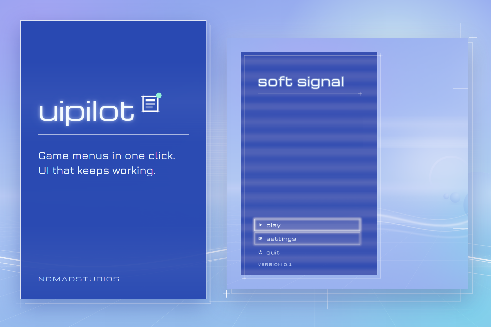
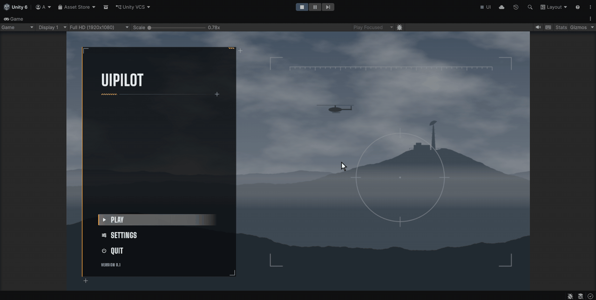

# UIPilot

**A finished game menu in one click, then a UI that stays healthy.**

UIPilot is a Unity Editor tool that builds your main, pause and settings
menus, wires every button to a GameManager script it writes for you,
and styles the lot with one of nine themes. What it builds is plain,
native UGUI and TextMeshPro that you own and can edit: no runtime
framework, no custom components.

Then it keeps watching. **UI Health** checks every UI in your scenes,
not only UIPilot's, for the bugs that make a button silently do nothing,
and fixes most of them in one click.

> **Coming soon to the Unity Asset Store.**
>
> This repository holds UIPilot's guide, media and issue tracker. It contains
> no source code: UIPilot is sold through the Unity Asset Store.

**[User guide](docs/README.md)** · **[Changelog](CHANGELOG.md)** ·
**[Report a bug](../../issues/new?template=bug_report.yml)** ·
**[Request a feature](../../issues/new?template=feature_request.yml)** ·
**[Email support](mailto:NomadStudios47@outlook.com)**

---

## See it in action

### 1. Build the menus

Tick the menus you want, pick a theme and click **Build UI**. UIPilot
creates the canvas, EventSystem, panels and buttons, writes
`UIPilot_GameManager.cs`, and wires every button once Unity has compiled it.

### 2. Change the look in one step

Pick another theme and click **Apply Theme to Existing Menus**. The look
changes (colours, fonts, frames and the scene behind the menu) while
the layout and wiring stay exactly as they were. Shown here:
Soft Club, Sci-Fi HUD, Pixel Retro, then Military Shooter.

### 3. Press Play: it already works

The menus work like a shipped game's front end. Settings opens and goes
back, the volume, fullscreen and quality controls respond, and
**Play** loads the scene you picked in the window (or hides the menu
if you picked none, as it does here).

---

## Nine themes

The look is one asset. Pick a theme, or duplicate one and make your own.
**Apply Theme to Existing Menus** restyles what you already built.

<table>
  <tr>
    <td> <b>Soft Club</b> (default)</td>
    <td> <b>Soft Club Night</b></td>
    <td> <b>Ink</b></td>
  </tr>
  <tr>
    <td> <b>Fantasy RPG</b></td>
    <td> <b>JRPG Window</b></td>
    <td> <b>Pixel Retro</b></td>
  </tr>
  <tr>
    <td> <b>Sci-Fi HUD</b></td>
    <td> <b>Military Shooter</b></td>
    <td> <b>Survival Horror</b></td>
  </tr>
</table>

More on each theme, and on making your own: [Themes](docs/themes.md).

---

## What you get

- **Build UI**: generates MainMenu, PauseMenu and SettingsMenu panels with a
  correctly set up Canvas, CanvasScaler, EventSystem, buttons and a wired
  GameManager script. One click.
- **A working front end**: Play loads the scene you pick (or hides the menu).
  Esc or Start opens Pause during play, freezes time and frees the cursor.
  Esc or B goes back one step. Quit asks once before it quits. Keyboard,
  mouse and gamepad, with either input system.
- **Nine themes**: Soft Club, Soft Club Night, Ink, Fantasy RPG, JRPG Window,
  Pixel Retro, Sci-Fi HUD, Military Shooter and Survival Horror.
- **Apply Theme**: restyles menus you already built without touching their
  layout or wiring. One Ctrl+Z undoes it.
- **Scenes and time of day**: a theme can put your own picture behind the
  menu, or its own layered scene that turns with the hour (Fantasy RPG,
  Military Shooter, Survival Horror).
- **UI Health**: checks all the UI in your open scenes as you work, on save,
  before Play and on every build. Broken click events, a missing or wrong
  EventSystem, canvases with no raycaster, invisible images eating a button's
  clicks, controls a gamepad can never reach, and text under the Steam Deck
  minimum. One-click, undoable fixes. Silent when everything is fine.
- **Click Debugger**: in Play mode, click anywhere and see what took the
  click and why. Works on any UI, with either input system.
- **Scan & Repair**: audits every UIPilot object in the scene and repairs
  what is missing or broken in one step.
- **Non-destructive**: UIPilot only creates and edits objects named
  `UIPilot_...`. UI Health reads all your UI but changes nothing until you
  click its Fix.
- **Editor-only**: all of UIPilot's code stays in the Editor. The only file
  that ships with your game is the GameManager script it writes for you to own.

---

## Quick start

1. Import UIPilot from the Asset Store.
2. Open **Tools → UIPilot**.
3. Tick the menus you want under **Build**, then click **Build UI**.
4. The first time, wait a few seconds while Unity compiles the new script.
   The buttons are wired when it finishes.
5. Press Play.

If your project has no TextMeshPro resources yet, UIPilot offers to import
them the first time. The full walkthrough is in the [user guide](docs/README.md).

---

## Requirements

- **Unity 6.3 LTS (6000.3) or newer.** Tested on 6000.3.11f1, Windows.
- Unity UI (`com.unity.ugui`, included with Unity), with TextMeshPro's
  Essential Resources imported.
- Any Active Input Handling setting: Input Manager, Input System, or Both.
- Built-in Render Pipeline or URP.

## Known limitations

- UGUI only. UI Toolkit is not supported.
- One UIPilot canvas per scene, with up to three menus: Main, Pause, Settings.
- UIPilot finds its objects by name: keep the `UIPilot_` GameObject names
  (the visible text is yours to change).

The full list is in [Troubleshooting](docs/troubleshooting.md#limitations).

---

## Get UIPilot

**Coming soon to the Unity Asset Store.**

---

## Support

Made by NomadStudios · [nom4d.dev](https://nom4d.dev)

- **Bugs and ideas:** [open an issue](../../issues/new/choose). Please search
  the existing issues first.
- **Purchase or private questions:** NomadStudios47@outlook.com.
  Never post an invoice number in a public issue.

Every report gets a response.

---

## License

© 2026 NomadStudios. All rights reserved. See [LICENSE](LICENSE).

UIPilot is sold through the Unity Asset Store and licensed under the
[Unity Asset Store EULA](https://unity.com/legal/as-terms).
This repository contains no source code.
