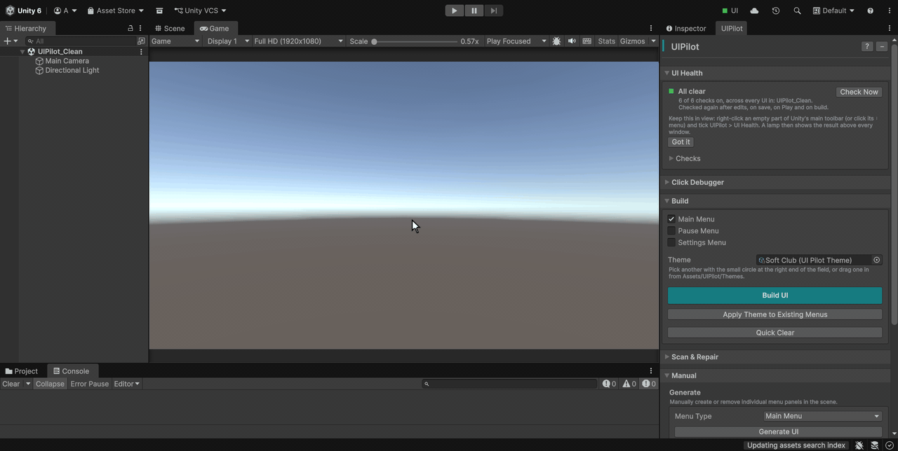
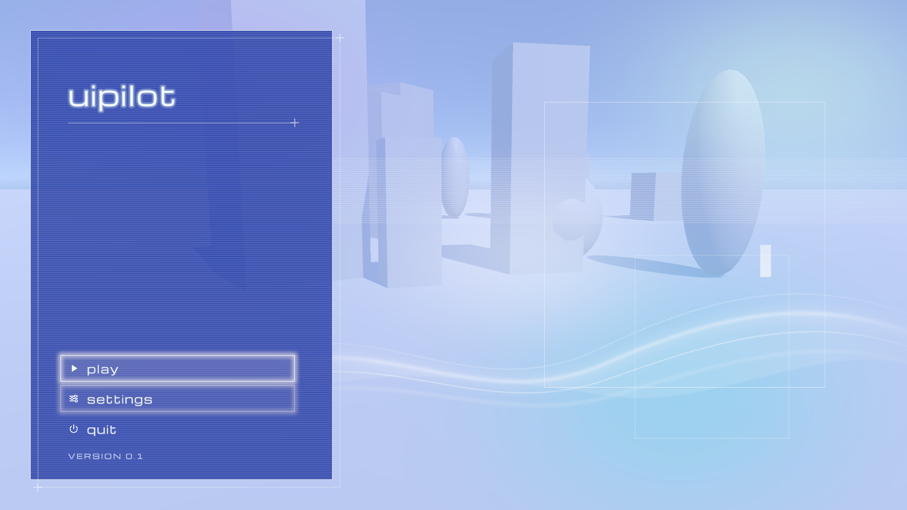
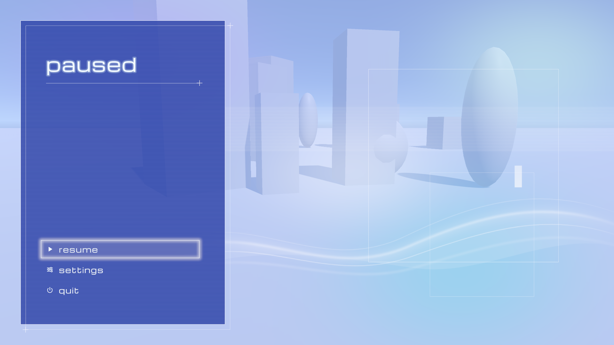
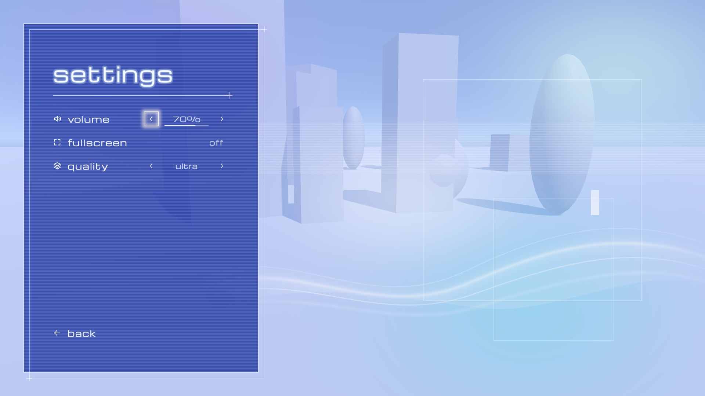

# UIPilot user guide

UIPilot builds a Main Menu, Pause Menu and Settings Menu out of standard Unity UI
(UGUI + TextMeshPro), writes a small script for the button logic, and connects
every button to it. It also watches **all** the UI in your scenes, not only its
own, and catches the mistakes that make a button silently do nothing.

Open it from the Unity menu bar: **Tools → UIPilot**.

| Page | What it covers |
|---|---|
| **This page** | Setup, your first menus, what gets created, Play, Pause and Settings |
| [Themes](themes.md) | The nine looks, Apply Theme, making your own, time of day |
| [UI Health](ui-health.md) | The checks that run as you work, and their fixes |
| [Click Debugger](click-debugger.md) | What took that click in Play mode, and why |
| [Troubleshooting](troubleshooting.md) | Common problems, and the limitations |

The full guide also ships inside the package, as
`Assets/UIPilot/Documentation/UIPilot_Documentation.pdf`.

---

## Requirements

| | |
|---|---|
| Unity | 6.3 LTS (6000.3) or newer. Tested on 6000.3.11f1, Windows. |
| Packages | Unity UI (`com.unity.ugui`), which includes TextMeshPro. Installed by default in every Unity 6 project. |
| TextMeshPro | TMP Essential Resources must be imported (UIPilot offers to do it). |
| Input | Input Manager, Input System Package, or Both. UIPilot picks the matching input module. |
| Render pipeline | Built-in or URP. The menus use a Screen Space - Overlay canvas, which does not depend on the pipeline. |

---

## Setup (about one minute)

1. **Import UIPilot.** Everything is placed in `Assets/UIPilot/`.
2. **Import the TextMeshPro essentials** if your project has no `Assets/TextMesh Pro`
   folder: **Window → TextMeshPro → Import TMP Essential Resources**. If you forget,
   UIPilot asks the first time you click **Build UI**.
3. **Open the scene** you want the menus in. Any scene works, including an empty one.
4. **Open Tools → UIPilot** and dock the window wherever you like.

## Your first menus

1. In the **Build** section, tick the menus you want. All three are ticked by default.
2. Click **Build UI**.
3. **The first time only, wait a few seconds** while Unity compiles the new script.
   The window shows an amber *Working* row, then a green *Ready* row. You do not
   need to click anything: the buttons are wired when it finishes.
4. **Press Play.** The main menu appears with your project's name and version, and
   the first button already focused.

Mouse, keyboard and gamepad all work with no extra setup.

---

## What UIPilot creates

<table>
  <tr>
    <td> Main menu</td>
    <td> Pause menu</td>
    <td> Settings menu</td>
  </tr>
</table>

**In the scene:**

- `UIPilot_Canvas`, set to Scale With Screen Size at 1920 x 1080, with a panel for
  each menu you ticked.
- An `EventSystem`, only if the scene has none.
- A `UIPilot_GameManager` object that every button calls: `UIPilot_Btn_Play` calls
  `OnPlayPressed`, and so on.

**In the project:**

- `Assets/UIPilot_GameManager.cs`: **your script.** One method per button, plus the
  code that shows and hides the panels and pauses the game. Edit it freely.
  UIPilot asks before it ever overwrites a file you have changed.
- `Assets/UIPilot/Themes/`: the nine looks. Editor-only, not part of your build.
- `Assets/UIPilot/Art/`: the menus' sprites, fonts and scenes. Keep this folder.

In Edit mode all panels are visible at once, stacked, so you see Settings on top.
That is normal: in Play mode the script shows only the main menu.

---

## Choose what Play does

After the first build, the Build section shows **Play loads**:

- **This scene (hides the menu)**, the default: the game carries on in this scene.
- **A scene from the list**: Play loads that scene. The list is your project's scene
  list in **File → Build Profiles**, so add your game scene there first.

## Pause and going back

| Press | While the game runs | In a menu |
|---|---|---|
| **Esc**, or **Start** on a gamepad | Opens the pause menu | Goes back one step |
| **B** on an Xbox pad (**Circle** on PlayStation) | Nothing: it stays your game's button | Goes back one step |

While paused, time is frozen and the cursor is free. **Resume** puts both back.
To pause from your own code, call `OpenPauseMenu()` on the GameManager.

## The Settings menu

**Volume**, **Fullscreen** and **Quality** work as soon as the menu is built, and the
player's choices are remembered the next time the game runs. To add a setting of
your own, duplicate a row, rename its buttons, and add the matching methods to your
script; the PDF guide walks through it.

---

## What UIPilot changes, and what it leaves alone

- It only creates and edits objects whose names start with `UIPilot_`, plus an
  `EventSystem` if your scene has none.
- **UI Health reads everything and changes nothing on its own.** It changes an object
  only when you click **Fix**, and one Ctrl+Z undoes it.
- **Build UI never rebuilds a panel that is already complete**, so your styling is safe.
- Keep the `UIPilot_` GameObject names: UIPilot finds its objects by name. The visible
  text is yours to change.
- All of UIPilot's code is in an `Editor` folder, which Unity never puts in a build.
  Your build gets `UIPilot_GameManager.cs` and only the artwork your menus use.

Next: [Themes](themes.md).
