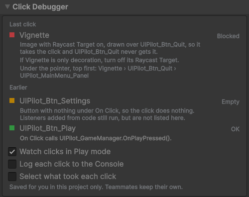

# Click Debugger

When a button does nothing in Play mode, the reason is usually invisible: an image
drawn over it, a switched-off CanvasGroup, a missing raycaster, an empty On Click.

Press **Play**, click anywhere in the Game view, and the **Click Debugger** section of
**Tools → UIPilot** says what took the click and why.

| You see | It means |
|---|---|
| **OK** | The click reached a control. The row shows the method it calls. |
| **Empty** | A button took the click, but nothing is set under On Click. |
| **Off** | The control has **Interactable** off, or sits in a CanvasGroup that does. |
| **Blocked** | Something with Raycast Target on is drawn over a control and takes its clicks. The row names both. |
| **Broken** | The control cannot receive clicks at all: no Graphic Raycaster, Raycast Target off, a mask hiding it, or no EventSystem. |
| **—** | Nothing clickable was there. |

The last click is shown in full, with every object under the pointer from top to
bottom; the five before it get a line each. Click a name to select that object.

Three switches sit under the list:

- **Watch clicks in Play mode**, on by default.
- **Log each click to the Console**, one line per click, even with the window closed.
- **Select what took each click**, as you play.

It works with any UI in the scene, not only UIPilot's, and with either input system.
It only reads: nothing in your scene is changed, and nothing of it goes into your build.

Next: [Troubleshooting](troubleshooting.md).
