# Themes

A **theme** is one asset that decides how every generated menu looks: the colours,
the lettering, the artwork, the scene behind the menu, and which decorations are on.
UIPilot ships nine, in `Assets/UIPilot/Themes`.

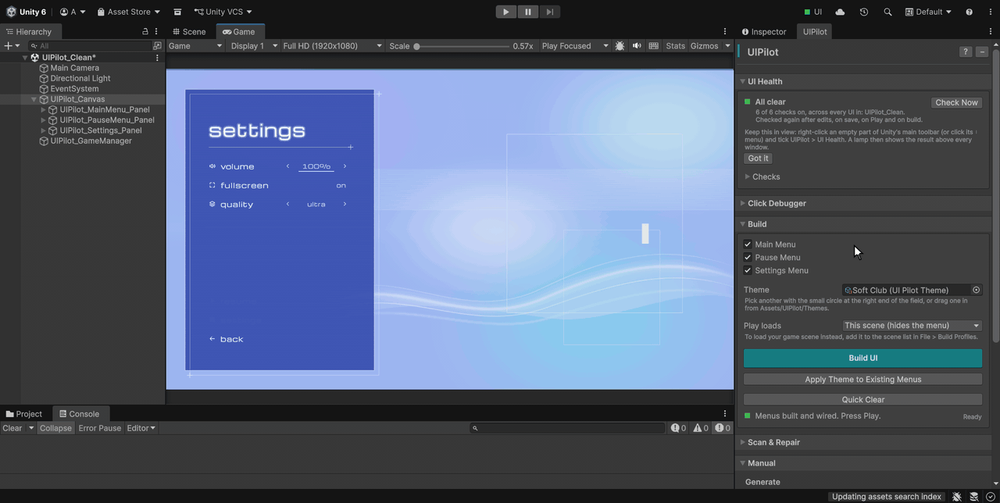

## The nine looks

| | Theme | The look |
|---|---|---|
| 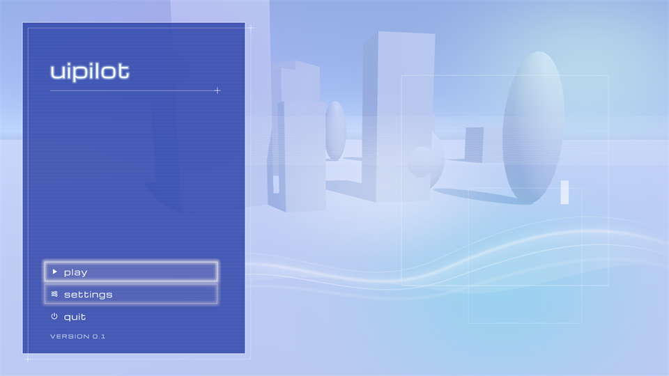 | **Soft Club** (default) | Airy blue wash over your scene, cobalt glass panel, hairline frames, a ribbon of light, wide lowercase lettering. |
| 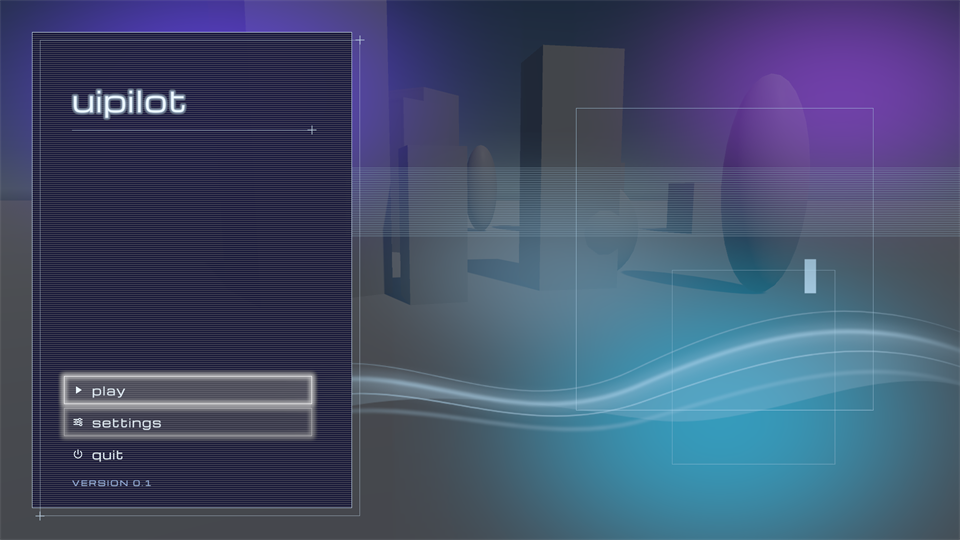 | **Soft Club Night** | The same artwork in a dark key: deep navy, violet and cyan light. |
| 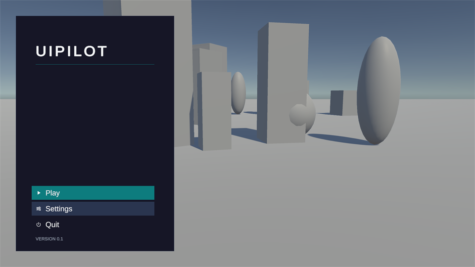 | **Ink** | Dark, flat and quiet: an opaque panel, a teal focus bar, no artwork. High contrast and genre-neutral. |
| 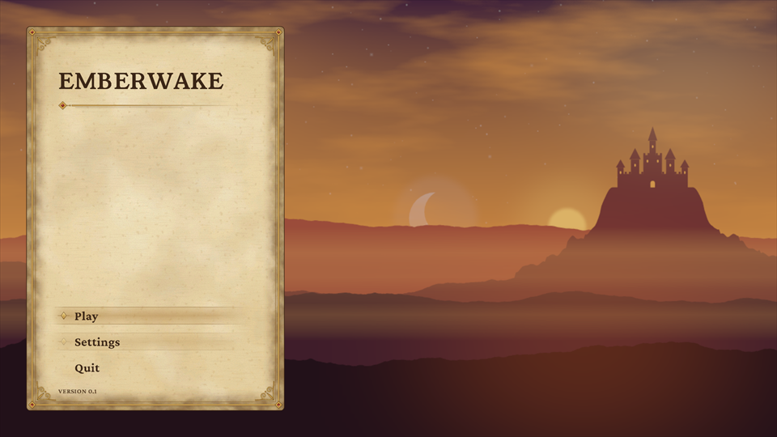 | **Fantasy RPG** | A parchment page in a gilt frame, lit by candlelight, with serif lettering in ink brown and a valley scene behind. |
| 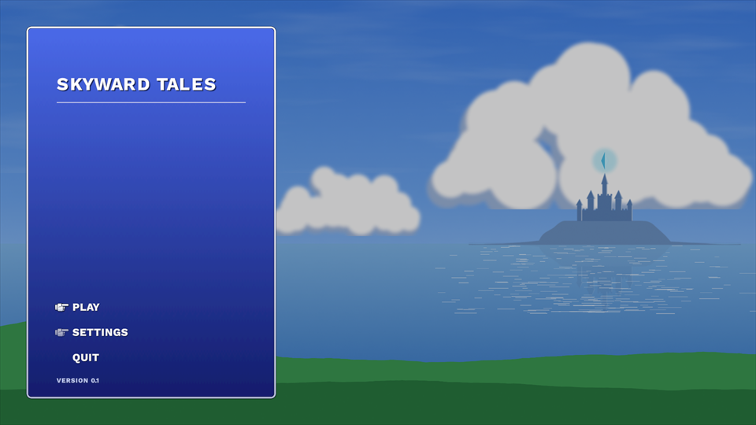 | **JRPG Window** | The console-RPG window: a blue gradient box with a white double border and a pointing glove as the cursor. |
| 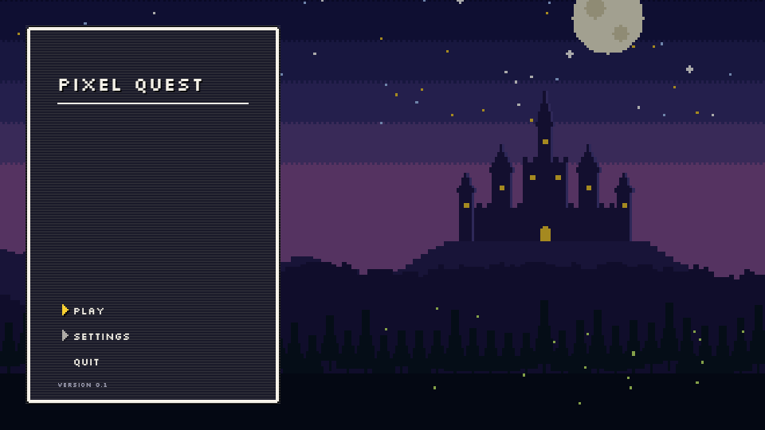 | **Pixel Retro** | 8-bit: a black window with a stepped border drawn in true pixels, pixel capitals, a yellow arrow cursor. |
| 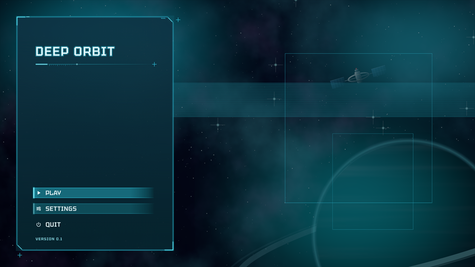 | **Sci-Fi HUD** | A starship console: a glass slab with cut corners edged in glowing cyan, instrument ticks, a scanning focus bar. |
| 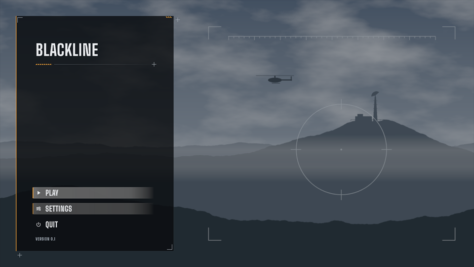 | **Military Shooter** | A near-black slab with one amber edge, condensed capitals, hazard stripes, over a grey valley with a radar station. |
| 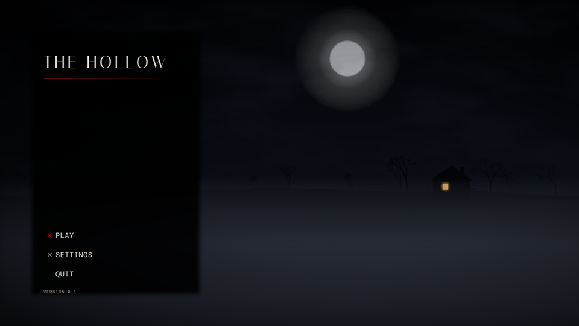 | **Survival Horror** | Quiet dread: a thin serif spaced wide, one rough red mark on the chosen line, dead trees, fog and a lit window. |

## Pick a theme

In the **Build** section, drag a theme from `Assets/UIPilot/Themes` into the **Theme**
field, or click the small circle at the right end of the field and pick one. Then
click **Build UI**.

## Restyle menus you already built

Pick the theme, then click **Apply Theme to Existing Menus**. Only the look changes:
your layout, object names, button order and wiring stay exactly as they were, and
one **Ctrl+Z** undoes it.

Apply sets colours and fonts again, so it replaces anything you changed by hand on
those menus. If you like tweaking, tweak the theme instead.

## Make your own

Select a theme in the Project window, press **Ctrl+D**, rename the copy, and edit it
in the Inspector. Every field has a tooltip. Pick your copy and click **Apply Theme
to Existing Menus** to see it.

A few fields worth knowing:

- **Panel** is the surface the text is read on. Keep it nearly opaque, and keep
  **Text** at a contrast of 4.5:1 or better against it.
- **Focus Style** marks the chosen button with a **Frame**, a **Bar**, or a **Marker**
  (a cursor before the words, like the JRPG glove).
- **Picture** puts your own key art behind the menu. It covers the screen and is
  cropped, never stretched.

Deleted one of the nine by mistake? A **Restore Default Themes** button appears under
the Theme field and brings it back exactly as it shipped.

Themes are Editor-only and never go into your build. To share one, copy its `.asset` file.

## Scenes and time of day

Fantasy RPG, Military Shooter and Survival Horror ship with their own layered scene
that changes with the hour, from midnight through dawn and noon to dusk:

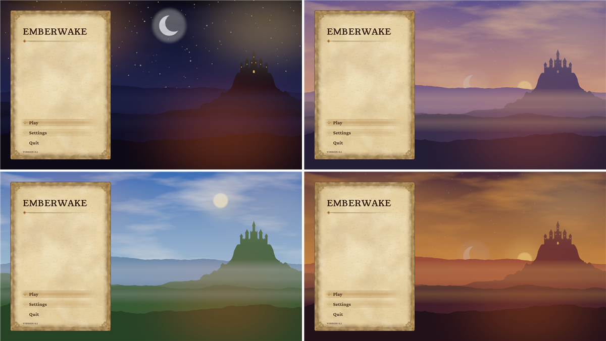

The `UIPilot_GameManager` in your scene owns the hour:

- **Time Of Day** is the hour the scene shows when the game starts (0 midnight,
  0.25 dawn, 0.5 noon, 0.75 dusk).
- **Day Length Seconds** above 0 runs the scene through a whole day on its own.
- `SetTimeOfDay(hour, seconds)` moves it from your code, at once or blended.

Next: [UI Health](ui-health.md).
