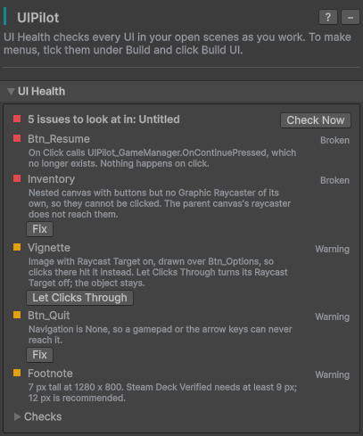
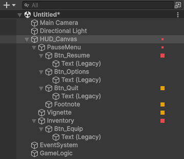
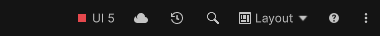

# UI Health

UI Health checks every UI in your open scenes, **including UI that UIPilot did not
build**, for the mistakes that make a control silently fail. It runs by itself: a
moment after you stop editing, when you save or open a scene, just before Play, and
on every build.

Checking never changes anything. A change is made only when you click **Fix**, and
one **Ctrl+Z** undoes it.

## Where you see it

| Where | What it shows |
|---|---|
| **Tools → UIPilot**, UI Health section | One row per issue: what is wrong, where, and what it means for the player. Click the name to select the object. |
| **Hierarchy** | A lamp next to each object with an issue (red: *Broken*, amber: *Warning*), and a small lamp on the objects above it. |
| **Main toolbar** | A lamp and a count above every window. Switch it on once: right-click an empty part of the main toolbar and tick **UIPilot → UI Health**. |
| **Console** | One warning when you enter Play mode, and one per scene when you build, only when there is something to look at. The build always continues. |

## What it checks

| Check | What it finds | What Fix does |
|---|---|---|
| **Click events** | A button, toggle, slider or other control whose event calls a deleted object or a renamed method, or has no function picked. Nothing happens when the player clicks. | No Fix: pick the method again in the Inspector. |
| **EventSystem** | No EventSystem, more than one, one without an input module, or the old input module in a project set to the new Input System. | Adds an EventSystem, or the input module the project needs. |
| **Graphic Raycasters** | A Canvas with buttons but no Graphic Raycaster, so nothing on it can be clicked. | Adds a Graphic Raycaster. |
| **Blocked buttons** | An image or text with **Raycast Target** on, drawn over a button, which takes its clicks. Typically a full-screen fade left at alpha 0, or a vignette. | **Let Clicks Through** turns off its Raycast Target. **Remove** is offered too when nothing uses it. |
| **Gamepad navigation** | A control a gamepad or the arrow keys can never reach, or one the player gets stuck on. | Sets Navigation to *Automatic*. |
| **Text size (Steam Deck)** | Text shorter than 9 px at 1280 x 800, Valve's minimum for Steam Deck Verified. | No Fix: click the row to select the text, then raise its size. |

## It does not cry wolf

A check that keeps raising false alarms gets ignored, so UI Health only reports what
it is sure of. Menus stacked on top of each other in the Editor are not reported as
blocking each other, and an event switched **Off** in the Inspector is left alone.

If a check does not suit your project, open **Checks** at the bottom of the section
and switch it off. These settings are yours only; teammates keep their own.

Next: [Click Debugger](click-debugger.md).
